<a href="https://aien.me">
  
</a>

<p align="center">
  <a href="https://aien.me"></a>
  <a href="https://www.linkedin.com/in/aiensaidi/"></a>
  <a href="mailto:hi@aien.me"></a>
  <a href="https://buymeacoffee.com/aientech"></a>
</p>

### `$ ls -t ~/blog | head -5`

<!-- BLOG-POST-LIST:START -->- `2026-10-22` [Is Vibe Coding Really That Bad?](https://aien.me/is-vibe-coding-really-that-bad/)
- `2026-10-15` [What Actually Goes Into a Game Design Document &lpar;Part 2: Design, Technical, and FAQ&rpar;](https://aien.me/what-actually-goes-into-a-game-design-document-part-2-design-technical-and-faq/)
- `2026-10-12` [What Actually Goes Into a Game Design Document &lpar;Part 1: The Concept Document&rpar;](https://aien.me/what-actually-goes-into-a-game-design-document-part-1-the-concept-document/)
- `2026-10-07` [What Actually Happens During Publishing](https://aien.me/what-actually-happens-during-publishing/)
- `2026-10-04` [What Actually Happens During Testing](https://aien.me/what-actually-happens-during-testing/)
<!-- BLOG-POST-LIST:END -->

<sub>↳ synced daily from <a href="https://aien.me/rss/">aien.me/rss</a> · <a href="https://aien.me">read everything →</a></sub>

### `$ wakatime --last-7-days`

<!--START_SECTION:waka-->

```txt
From: 20 October 2026 - To: 27 October 2026

Total Time: 0 secs

No activity tracked
```

<!--END_SECTION:waka-->

<br>

<p align="center">
  <a href="https://buymeacoffee.com/aientech"><code>$ sudo make me a coffee ☕</code></a>
  <br>
  <sub>keeps the backends running and the posts coming</sub>
</p>
